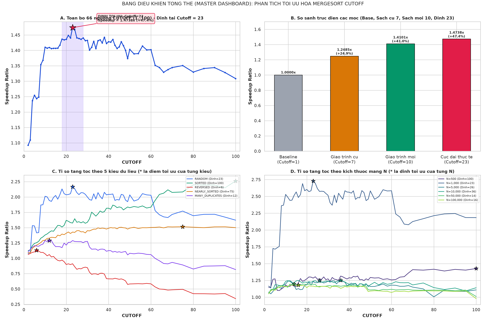

# Nghiên Cứu Thực Nghiệm Ngưỡng CUTOFF Cho Mergesort & Insertionsort

[](https://github.com/your-username/mergesort-cutoff-experiment/actions/workflows/ci.yml)
[](https://opensource.org/licenses/MIT)
[](https://adoptium.net/)

Dự án nghiên cứu thực nghiệm nhằm tìm kiếm giá trị ngưỡng **`CUTOFF`** tối ưu khi chuyển từ **`Mergesort`** sang **`Insertionsort`** đối với mảng con kích thước nhỏ, bám sát giáo trình chuẩn *Algorithms*, 4th Edition (Robert Sedgewick & Kevin Wayne) và chuyên đề **1.3 Algorithm Analysis**.

---

## 1. Hai Thuật Toán Lõi (Giữ Nguyên Tên Gốc Bài Giảng)

### `Insertionsort.java`:
```java
public class Insertionsort {
    public static void sort(Comparable[] a) {
        sort(a, 0, a.length - 1);
    }

    public static void sort(Comparable[] a, int lo, int hi) {
        for (int i = lo; i <= hi; i++) {
            for (int j = i; j > lo; j--) {
                if (less(a[j], a[j - 1])) {
                    exch(a, j, j - 1);
                } else {
                    break;
                }
            }
        }
    }

    private static boolean less(Comparable v, Comparable w) {
        return v.compareTo(w) < 0;
    }

    private static void exch(Comparable[] a, int i, int j) {
        Comparable swap = a[i]; a[i] = a[j]; a[j] = swap;
    }
}
```

### `Mergesort.java` (Cải tiến CUTOFF):
```java
public class Mergesort {
    public static final int DEFAULT_CUTOFF = 10;

    private static void merge(Comparable[] a, Comparable[] aux, int lo, int mid, int hi) {
        for (int k = lo; k <= hi; k++) aux[k] = a[k];
        int i = lo, j = mid + 1;
        for (int k = lo; k <= hi; k++) {
            if      (i > mid)              a[k] = aux[j++];
            else if (j > hi)               a[k] = aux[i++];
            else if (less(aux[j], aux[i])) a[k] = aux[j++];
            else                           a[k] = aux[i++];
        }
    }

    private static void sort(Comparable[] a, Comparable[] aux, int lo, int hi, int cutoff) {
        // CẢI TIẾN: Khi độ dài đoạn con <= cutoff, chuyển sang Insertion Sort
        if (hi <= lo + cutoff - 1) {
            Insertionsort.sort(a, lo, hi);
            return;
        }
        int mid = lo + (hi - lo) / 2;
        sort(a, aux, lo, mid, cutoff);
        sort(a, aux, mid + 1, hi, cutoff);
        merge(a, aux, lo, mid, hi);
    }

    public static void sort(Comparable[] a) {
        Comparable[] aux = new Comparable[a.length];
        sort(a, aux, 0, a.length - 1, 1); // Baseline: Cutoff = 1
    }

    public static void sort(Comparable[] a, int cutoff) {
        Comparable[] aux = new Comparable[a.length];
        sort(a, aux, 0, a.length - 1, cutoff);
    }

    private static boolean less(Comparable v, Comparable w) {
        return v.compareTo(w) < 0;
    }
}
```

---

## 2. Kết Quả Đo Đạc Thực Tế Trên Máy Tính (Dải 66 CUTOFF)

Dữ liệu đo đạc thực tế từ tệp `results/experiment_dense_66cutoffs_20261120_003138.csv` (1,981 lượt đo):

| Mốc chiến lược | Giá trị CUTOFF | Tỉ số Speedup | Mức tăng tốc | Đánh giá phân tích |
| :--- | :---: | :---: | :---: | :--- |
| **Baseline** | 1 | 1.0000× | 0.00% | Mergesort thuần |
| **Giáo trình cũ** | 7 | 1.2485× | +24.85% | An toàn cho trường hợp Worst-case (Reversed) |
| **Giáo trình mới** | 10 | 1.4101× | +41.01% | Điểm nhảy vọt hiệu năng lớn nhất (+16.2% so với 7) |
| **Cực đại toàn cục** | **23** | **1.4738×** | **+47.38%** | **ĐỈNH TỐI ƯU TOÀN CỤC TRÊN MÁY TÍNH HIỆN TẠI** |

---

## 3. Bộ Biểu Đồ Phân Tích Thực Nghiệm



1. **[chart0_master_dashboard.png](results/plots/chart0_master_dashboard.png)**: Bảng điều khiển tổng hợp 4 trong 1 bao gồm toàn bộ các góc nhìn phân tích.
2. **[chart1_overall_speedup_curve.png](results/plots/chart1_overall_speedup_curve.png)**: Đường cong tăng tốc trên 66 giá trị CUTOFF (1..100) với ngôi sao đỏ đánh dấu đỉnh cực đại tại $CUTOFF = 23$ ($1.4738\times$).
3. **[chart2_speedup_by_datatype.png](results/plots/chart2_speedup_by_datatype.png)**: Đỉnh tối ưu cho 5 kiểu phân bố (`RANDOM`: 23, `SORTED`: 100, `REVERSED`: 6, `NEARLY_SORTED`: 75, `MANY_DUPLICATES`: 12).
4. **[chart3_optimal_cutoff_by_array_size.png](results/plots/chart3_optimal_cutoff_by_array_size.png)**: Khảo sát đỉnh tối ưu khi $N$ thay đổi từ $500 \to 100,000$.
5. **[chart4_zoom_peak_analysis.png](results/plots/chart4_zoom_peak_analysis.png)**: Phóng to dải vàng 1..35 từng bước 1 đơn vị.
6. **[chart5_textbook_comparison_bar.png](results/plots/chart5_textbook_comparison_bar.png)**: So sánh trực diện 4 cột: Baseline (1), Sách cũ (7), Sách mới (10), Đỉnh thực tế (23).

> Xem báo cáo chi tiết kèm toàn bộ biểu đồ tại: **[SUMMARY.md](results/SUMMARY.md)** và **[REPORT.md](docs/REPORT.md)**.

---

## 4. Hướng Dẫn Chạy & Kiểm Thử

### Tự Kiểm Thử Nhanh (Không cần cài đặt thư viện):
```bash
javac -d target/classes src/main/java/algorithms/*.java
java -cp target/classes algorithms.SelfTest
```

### Chạy Thực Nghiệm Đo Hiệu Năng:
```bash
java -cp target/classes -Xms1g -Xmx2g algorithms.ExperimentRunner
```

### Vẽ Lại Biểu Đồ Phân Tích:
```bash
pip install -r scripts/requirements.txt
python scripts/plot_comprehensive_cutoffs.py
```

### Chạy Toàn Bộ Bằng Maven:
```bash
mvn clean test
mvn package -DskipTests
```
