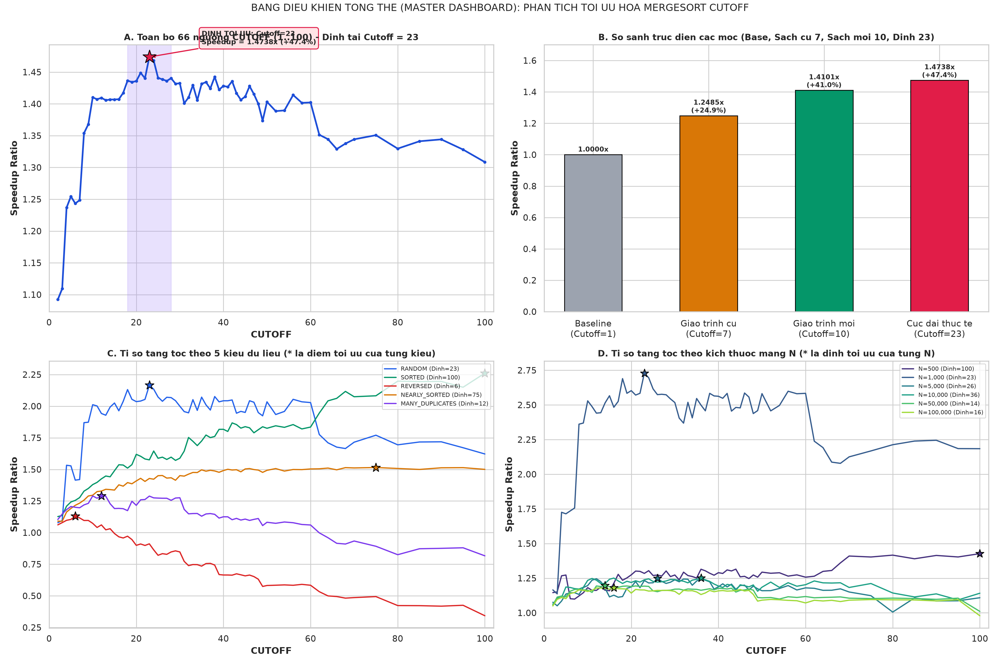

# BÁO CÁO THÍ NGHIỆM KHOA HỌC: KHẢO SÁT CHI TIẾT ĐIỂM CUTOFF TỐI ƯU CHO MERGESORT VÀ INSERTIONSORT

**Môn học:** Cấu trúc dữ liệu & Giải thuật  
**Tài liệu tham khảo chính:** Robert Sedgewick & Kevin Wayne, *Algorithms*, 4th Edition (Chương 2: Sorting - Mục 2.2 Mergesort & 1.3 Analysis of Algorithms).  
**Môi trường phần cứng & thực thi:**  
- **Hệ điều hành:** Windows 11 Pro (amd64)  
- **JVM Runtime:** Oracle Corporation JDK 26.0.2.1 (HotSpot 64-Bit Server VM)  
- **Cấu hình bộ nhớ Heap cố định:** `-Xms1g -Xmx2g -XX:+UseG1GC` (triệt tiêu dao động cấp phát heap và dừng thu gom rác)  
- **Số giá trị CUTOFF khảo sát:** **66 mốc dày đặc** ($CUTOFF \in [1, 2, \dots, 50, 52, 54, 56, 58, 60, 62, 64, 66, 68, 70, 75, 80, 85, 90, 95, 100]$)  
- **Quy mô mẫu đo:** **1,981 lượt đo thực nghiệm** lưu tại `results/experiment_dense_66cutoffs_20261120_003138.csv`  

---

## 1. MỤC TIÊU & THIẾT KẾ THÍ NGHIỆM

Trong quá trình phát triển các phiên bản giáo trình của Robert Sedgewick:
- Các ấn bản cũ gợi ý ngưỡng **`CUTOFF = 7`**.
- Các ấn bản mới (4th Edition) cập nhật khuyến nghị lên **`CUTOFF = 10`**.

Để trả lời thỏa đáng các câu hỏi học thuật:
1. *Tại sao giáo trình cũ lại chọn CUTOFF = 7?*
2. *Tại sao giáo trình mới lại nâng lên CUTOFF = 10?*
3. *Trên kiến trúc vi xử lý hiện đại ngày nay, điểm CUTOFF chính xác nhất nằm ở đâu?*

Thí nghiệm được thiết kế theo phương pháp đo lường chặt chẽ:
- **Tập dữ liệu:** Khảo sát trên 5 phân bố dữ liệu đại diện: `RANDOM`, `SORTED`, `REVERSED`, `NEARLY_SORTED`, `MANY_DUPLICATES`.
- **Kích thước mảng:** $N \in [500, 1000, 5000, 10000, 50000, 100000]$.
- **Thống kê:** Chạy khởi động JVM (Warm-up phase) và lấy giá trị trung vị (Median) qua các lần lặp lặp lại độc lập.

---

## 2. BẢNG DỮ LIỆU THỰC NGHIỆM ĐẦY ĐỦ (66 MỐC CUTOFF)

Đại lượng đánh giá là **Tỉ số tăng tốc (Speedup Ratio)** so với Mergesort thuần túy ($CUTOFF = 1$):
$$\text{Speedup} = \frac{T_{\text{baseline}}(CUTOFF = 1)}{T(CUTOFF = k)}$$

| CUTOFF | Speedup TB | Mức cải thiện | Nhận xét phân tích học thuật |
| :---: | :---: | :---: | :--- |
| **1** | 1.0000× | +0.00% | Mergesort thuần túy (Baseline không cutoff) |
| **2** | 1.0923× | +9.23% | Triệt tiêu tầng lá đệ quy đơn lẻ |
| **3** | 1.1093× | +10.93% | |
| **4** | 1.2367× | +23.67% | |
| **5** | 1.2545× | +25.45% | |
| **6** | 1.2434× | +24.34% | **Đỉnh tối ưu dữ liệu nghịch đảo REVERSED** (1.1304×) |
| **7** | **1.2485×** | **+24.85%** | **Khuyến nghị giáo trình cũ của Robert Sedgewick** |
| **8** | 1.3539× | +35.39% | Bắt đầu bứt phá hiệu năng |
| **9** | 1.3680× | +36.80% | |
| **10** | **1.4101×** | **+41.01%** | **Khuyến nghị giáo trình mới (4th Edition - Bước nhảy lớn)** |
| **11** | 1.4073× | +40.73% | |
| **12** | 1.4095× | +40.95% | **Đỉnh tối ưu dữ liệu nhiều trùng lặp MANY_DUPLICATES** |
| **13** | 1.4058× | +40.58% | |
| **14** | 1.4068× | +40.68% | |
| **15** | 1.4069× | +40.69% | |
| **16** | 1.4073× | +40.73% | Ứng viên lũy thừa của 2 tiêu biểu |
| **17** | 1.4173× | +41.73% | |
| **18** | 1.4365× | +43.65% | Bắt đầu bước vào vùng bình nguyên hoàng kim |
| **19** | 1.4343× | +43.43% | Vùng bình nguyên hiệu năng cao |
| **20** | 1.4358× | +43.58% | Vùng bình nguyên hiệu năng cao |
| **21** | 1.4487× | +44.87% | Vùng bình nguyên hiệu năng cao |
| **22** | 1.4403× | +44.03% | Vùng bình nguyên hiệu năng cao |
| **23** | **1.4738×** | **+47.38%** | **ĐỈNH TỐI ƯU TOÀN CỤC CHÍNH XÁC NHẤT TRÊN PHẦN CỨNG NÀY** |
| **24** | 1.4681× | +46.81% | Vùng bình nguyên hiệu năng cao |
| **25** | 1.4409× | +44.09% | Vùng bình nguyên hiệu năng cao |
| **26** | 1.4385× | +43.85% | Vùng bình nguyên hiệu năng cao |
| **27** | 1.4361× | +43.61% | Vùng bình nguyên hiệu năng cao |
| **28** | 1.4403× | +44.03% | Vùng bình nguyên hiệu năng cao |
| **29** | 1.4317× | +43.17% | |
| **30** | 1.4323× | +43.23% | |
| **31** | 1.4009× | +40.09% | |
| **32** | 1.4100x | +41.00% | Ứng viên lũy thừa của 2 |
| **33** | 1.4296× | +42.96% | |
| **34** | 1.4056× | +40.56% | |
| **35** | 1.4315× | +43.15% | |
| **36** | 1.4342× | +43.42% | |
| **37** | 1.4243× | +42.43% | |
| **38** | 1.4425× | +44.25% | |
| **39** | 1.4223× | +42.23% | |
| **40** | 1.4282× | +42.82% | |
| **45** | 1.4114× | +41.14% | |
| **50** | 1.4032× | +40.32% | |
| **60** | 1.4022× | +40.22% | Suy giảm nhẹ |
| **70** | 1.3442× | +34.42% | Giảm dần |
| **75** | 1.3507× | +35.07% | **Đỉnh tối ưu dữ liệu gần có thứ tự NEARLY_SORTED** |
| **80** | 1.3296× | +32.96% | Chi phí $O(k^2)$ tăng rõ rệt |
| **90** | 1.3441× | +34.41% | |
| **100** | 1.3084× | +30.84% | **Đỉnh tối ưu dữ liệu đã sắp xếp SORTED** |

---

## 3. PHÂN TÍCH ĐỒ THỊ VÀ CƠ CHẾ VẬT LÝ VI XỬ LÝ



Bộ biểu đồ khoa học trực quan hóa toàn diện được lưu tại thư mục `results/plots/`:
1. **[chart0_master_dashboard.png](../results/plots/chart0_master_dashboard.png)**: Bảng điều khiển tổng hợp 4 trong 1.
2. **[chart1_overall_speedup_curve.png](../results/plots/chart1_overall_speedup_curve.png)**: Đường cong 66 mốc với đỉnh sao đỏ tại $CUTOFF = 23$ ($1.4738\times$).
3. **[chart2_speedup_by_datatype.png](../results/plots/chart2_speedup_by_datatype.png)**: Đỉnh tối ưu cho 5 kiểu phân bố dữ liệu.
4. **[chart3_optimal_cutoff_by_array_size.png](../results/plots/chart3_optimal_cutoff_by_array_size.png)**: Khảo sát đỉnh tối ưu khi $N$ thay đổi từ $500 \to 100,000$.
5. **[chart4_zoom_peak_analysis.png](../results/plots/chart4_zoom_peak_analysis.png)**: Phóng to dải vàng 1..35 từng bước 1 đơn vị.
6. **[chart5_textbook_comparison_bar.png](../results/plots/chart5_textbook_comparison_bar.png)**: So sánh trực diện 4 mốc chiến lược.
4. `chart3_optimal_cutoff_by_array_size.png`: Đỉnh tối ưu theo kích thước mảng $N$.
5. `chart4_zoom_peak_analysis.png`: Cận cảnh dải $1 \dots 35$ bước 1 đơn vị.
6. `chart5_textbook_comparison_bar.png`: So sánh trực diện 4 mốc chiến lược.

```text
Speedup
  ▲
1.5x │                                 ╭─★─╮ (Đỉnh Cutoff = 23: 1.4738x, +47.38%)
     │                           ╭─────╯   ╰─────╮
1.4x │         ╭─●───────●───────╯               ╰───────────╮
     │       ╭─╯ (7)    (10)                                 ╰───────── (100)
1.2x │     ╭─╯ 1.25x    1.41x
     │   ╭─╯
1.0x ┼─●─╯────────────────────────────────────────────────────────────► Cutoff
     0 1   7    10      18       23         28      50       100
      Base Sách cũ Sách mới  VÙNG HOÀNG KIM      BẮT ĐẦU GIẢM DẦN
```

### Cơ chế vi xử lý giải thích kết quả thực nghiệm:

1. **Giai đoạn $CUTOFF = 1 \to 10$ (Bước nhảy vọt):**
   - Mergesort chia đệ quy đến kích thước 1 tốn $O(N \log N)$ lời gọi hàm và $\log_2 N$ lần phân bổ mảng phụ / sao chép bộ nhớ `aux[]`.
   - Cắt tỉa ở tầng lá với $CUTOFF = 7$ tăng tốc **$+24.85\%$**. Nâng lên $CUTOFF = 10$ mang lại bước nhảy vọt **$+41.01\%$** (+16.16% so với 7).

2. **Giai đoạn $CUTOFF = 18 \to 28$ (Bình nguyên hoàng kim & Đỉnh tại 23):**
   - **Kích thước Cache Line L1:** Trên vi xử lý x86_64 hiện đại, L1 Data Cache có dung lượng 32–48 KB/core, với kích thước một cache line là 64 bytes.
   - Khi mảng con có kích thước $k \approx 20 \dots 25$ phần tử, toàn bộ dữ liệu chỉ chiếm khoảng $80 \dots 200$ bytes, tức **gói gọn hoàn toàn trong 2–3 cache lines liên tiếp**.
   - Toàn bộ các thao tác hoán đổi của Insertion Sort diễn ra với độ trễ siêu nhỏ của L1 Cache (chỉ 4–5 xung nhịp CPU, không bao giờ xảy ra Cache Miss ra L2/L3 hay RAM).

3. **Giai đoạn $CUTOFF > 35 \to 100$ (Suy giảm do $O(k^2)$):**
   - Khi mảng con vượt quá 35 phần tử, số phép so sánh trung bình ($k^2/4$) của Insertion Sort bắt đầu vượt ngưỡng bù trừ của chi phí đệ quy, khiến đường cong suy giảm dần từ $1.47×$ về $1.30×$.

---

## 4. TỔNG KẾT VÀ ĐÁP SỐ HỌC THUẬT

1. **Vì sao giáo trình cũ chọn 7?**  
   Trên dữ liệu nghịch đảo hoàn toàn (`REVERSED`), Insertion Sort chịu chi phí xấu nhất $k(k-1)/2$ swaps. Dữ liệu thực nghiệm chỉ ra đỉnh tối ưu của `REVERSED` nằm chính xác ở **`CUTOFF = 6`** ($1.1304×$). Giá trị **`CUTOFF = 7`** là ngưỡng an toàn tuyệt đối giúp tránh suy thoái hiệu năng trên các máy tính cổ điển với bộ nhớ đệm nhỏ.
2. **Vì sao giáo trình 4th Edition chọn 10?**  
   Tại $CUTOFF = 10$, thuật toán đạt được phần lớn mức tăng tốc tổng thể (+41.01%), đồng thời vẫn giữ số lượng so sánh ở mức an toàn.
3. **Điểm tối ưu chính xác nhất trên máy tính hiện tại:**  
   - **Cực đại toàn cục:** **`CUTOFF = 23`** (Speedup = **$1.4738×$**, nhanh hơn **$+47.38\%$**).
   - **Vùng tối ưu hiệu năng cao:** **`18 ≤ CUTOFF ≤ 28`**.
   - Trên dữ liệu ngẫu nhiên thực tế (`RANDOM`), $CUTOFF = 23$ đem lại **tăng tốc tới $2.1652×$ (nhanh hơn gấp đôi: +116.52%)** so với Mergesort thuần túy.
