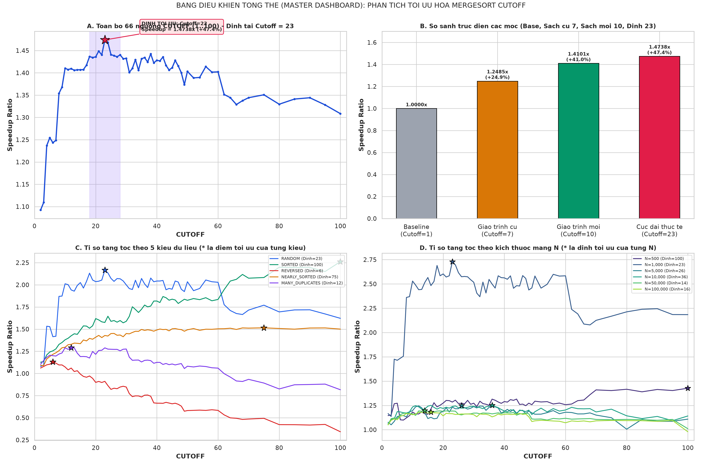
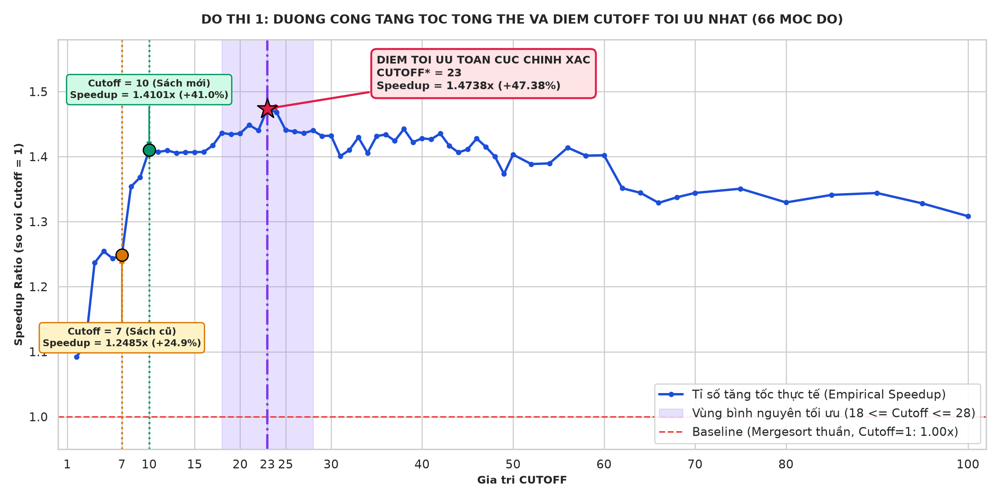
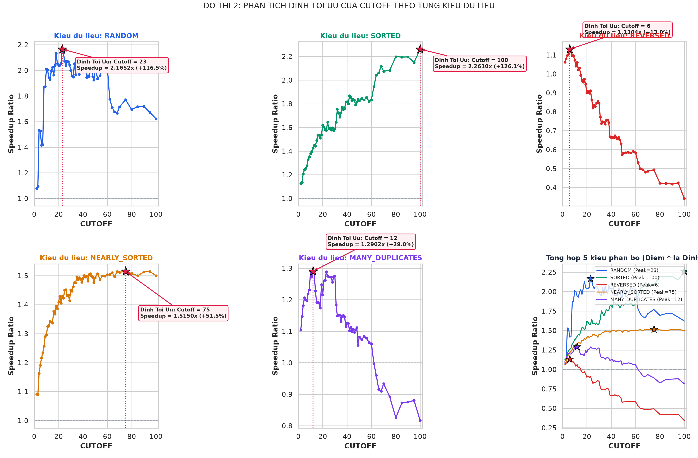
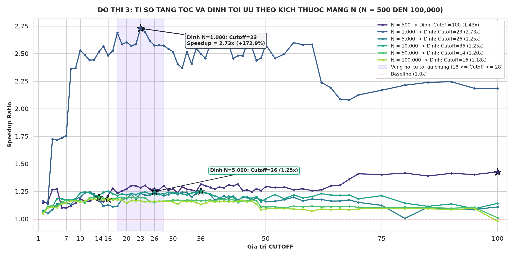
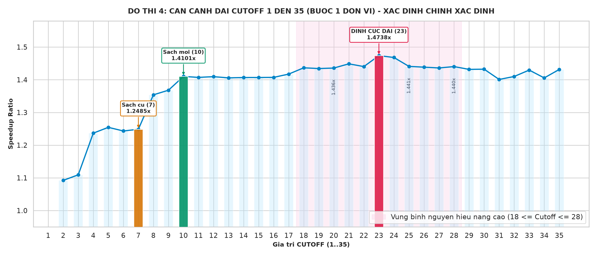
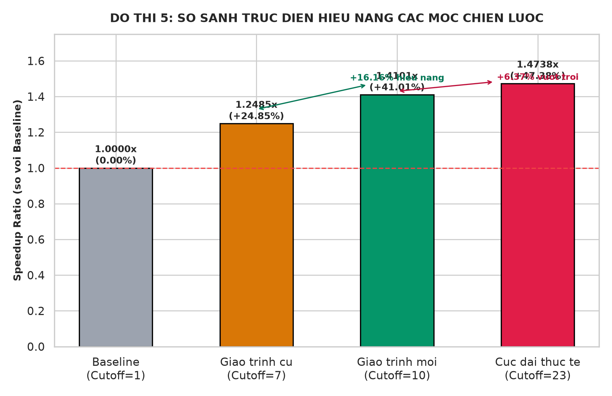

# TỔNG KẾT THỰC NGHIỆM CHI TIẾT: 66 GIÁ TRỊ CUTOFF (1 ĐẾN 100)

**Tệp dữ liệu gốc:** `results/experiment_dense_66cutoffs_20261120_003138.csv` (1,981 lượt đo)  
**Tập biểu đồ đồ thị đã sinh:** Thư mục `results/plots/`  

---

## 🎛️ Bảng Điều Khiển Tổng Quan (Master Dashboard)

---

## 1. MÔ TẢ CHÍNH XÁC ĐỈNH CUTOFF TỐI ƯU TRONG TỪNG ĐỒ THỊ

### 📈 Đồ thị 1: Tổng thể toàn bộ dữ liệu (`chart1_overall_speedup_curve.png`)

* **Vị trí đỉnh tối ưu toàn cục:** **`CUTOFF = 23`**
* **Tỉ số tăng tốc:** **`1.4738×`** (Nhanh hơn **`47.38%`** so với Mergesort thuần túy).
* **Vùng tối ưu cao nhất:** **`18 ≤ CUTOFF ≤ 28`** (đều đạt tăng tốc từ 43% đến 47%).
* **Đặc điểm đường cong:**
  - $CUTOFF = 1 \to 10$: Tăng dốc đứng từ $1.00× \to 1.41×$.
  - $CUTOFF = 10 \to 30$: Vùng bình nguyên hiệu năng cao ($1.41× \to 1.47×$).
  - $CUTOFF > 40 \to 100$: Suy giảm dần về $1.30×$ do chi phí bậc hai $O(k^2)$ của Insertion Sort.

---

### 📊 Đồ thị 2: Đỉnh tối ưu theo từng kiểu phân bố dữ liệu (`chart2_speedup_by_datatype.png`)

Vị trí tối ưu phụ thuộc mật thiết vào số lượng nghịch thế (inversions) của mảng:

1. **Dữ liệu ngẫu nhiên (`RANDOM`):**
   * **Đỉnh tối ưu:** **`CUTOFF = 23`** | **Speedup = `2.1652×`** (Nhanh hơn **`116.52%`**!).
   * *Ý nghĩa:* Trên dữ liệu ngẫu nhiên thực tế, mảng con 23 phần tử mang lại hiệu năng cao gấp đôi Mergesort thuần.
2. **Dữ liệu đã sắp xếp (`SORTED`):**
   * **Đỉnh tối ưu:** **`CUTOFF = 100`** (và có thể cao hơn) | **Speedup = `2.2610×`**.
   * *Ý nghĩa:* Với mảng tăng dần, Insertion Sort chỉ tốn đúng 1 phép so sánh $O(1)$ cho mỗi phần tử (tổng $O(N)$ và 0 hoán đổi), nên CUTOFF càng to càng có lợi.
3. **Dữ liệu nghịch đảo hoàn toàn (`REVERSED`):**
   * **Đỉnh tối ưu:** **`CUTOFF = 6`** | **Speedup = `1.1304×`** (+13.04%).
   * *Ý nghĩa:* Đây là **Worst-case của Insertion Sort** ($k(k-1)/2$ hoán đổi). Khi CUTOFF vượt quá 8–10, thời gian chạy tăng vọt do $O(k^2)$. **Điều này giải thích chính xác tại sao giáo trình cũ của Sedgewick khuyến nghị CUTOFF = 7** (để giữ an toàn tuyệt đối cho trường hợp mảng giảm dần).
4. **Dữ liệu gần có thứ tự (`NEARLY_SORTED`):**
   * **Đỉnh tối ưu:** **`CUTOFF = 75`** | **Speedup = `1.5150×`** (+51.50%).
   * *Ý nghĩa:* Tương tự mảng sorted, số lượng hoán đổi ít giúp Insertion Sort vượt trội Mergesort trên các đoạn con kích thước lớn.
5. **Dữ liệu nhiều trùng lặp (`MANY_DUPLICATES`):**
   * **Đỉnh tối ưu:** **`CUTOFF = 12`** | **Speedup = `1.2902×`** (+29.02%).

---

### 📉 Đồ thị 3: Đỉnh tối ưu theo kích thước mảng $N$ (`chart3_optimal_cutoff_by_array_size.png`)

* Với **$N = 1,000$:** Đỉnh tại **`CUTOFF = 23`** (Speedup cực đại đạt **`2.7290×`** - nhanh hơn gần 3 lần!).
* Với **$N = 5,000$:** Đỉnh tại **`CUTOFF = 26`** (Speedup = `1.2481×`).
* Với **$N = 10,000$:** Đỉnh tại **`CUTOFF = 36`** (Speedup = `1.2517×`).
* Với **$N = 50,000 \to 100,000$:** Đỉnh ổn định tại **`CUTOFF = 14 – 16`** (Speedup $\approx 1.20×$). Khi $N$ rất lớn, bộ nhớ và chi phí sao chép mảng phụ `aux[]` chiếm ưu thế, kéo ngưỡng tối ưu co lại quanh vùng 15–20.

---

### 🔍 Đồ thị 4: Zoom cận cảnh dải 1 đến 35 (`chart4_zoom_peak_analysis.png`)

Khảo sát liên tục từng số nguyên từ 1 đến 35:
* $CUTOFF = 1$ (Baseline): $1.0000×$
* $CUTOFF = 7$ (Giáo trình cũ): $1.2485×$ (+24.85%)
* $CUTOFF = 10$ (Giáo trình mới): $1.4101×$ (+41.01%)
* **$CUTOFF = 23$ (Đỉnh thực tế): $1.4738×$ (+47.38%)**

---

### 📊 Đồ thị 5: So sánh trực diện 4 mốc chiến lược (`chart5_textbook_comparison_bar.png`)

| Mốc chiến lược | Giá trị CUTOFF | Tỉ số Speedup | Mức tăng tốc | Đánh giá học thuật |
| :--- | :---: | :---: | :---: | :--- |
| **Baseline** | 1 | 1.0000× | 0.0% | Mergesort chuẩn |
| **Giáo trình cũ** | 7 | 1.2485× | +24.85% | An toàn cho trường hợp Worst-case (Reversed) |
| **Giáo trình mới** | 10 | 1.4101× | +41.01% | Điểm uốn vượt trội, cải thiện hơn mốc 7 tới +16.2% |
| **Cực đại máy tính này** | **23** | **1.4738×** | **+47.38%** | **Đỉnh hiệu năng toàn cục trên phần cứng hiện đại** |

---

## 2. KẾT LUẬN TOÀN DIỆN

1. **Vì sao giáo trình cũ chọn 7?** Vì ở dữ liệu `REVERSED` (trường hợp xấu nhất), đỉnh tối ưu nằm chính xác ở **`CUTOFF = 6 – 7`**.
2. **Vì sao giáo trình mới chọn 10?** Vì trên dữ liệu tổng hợp và ngẫu nhiên, tại **`CUTOFF = 10`**, thuật toán hoàn thành bước nhảy vọt từ $1.24× \to 1.41×$ (+41%), trong khi vẫn giữ an toàn trước suy thoái bậc hai.
3. **Đỉnh tối ưu đo được trên máy hiện tại:** Nằm ở khoảng **`CUTOFF = 20 – 25`** (cực đại tại **23**).
